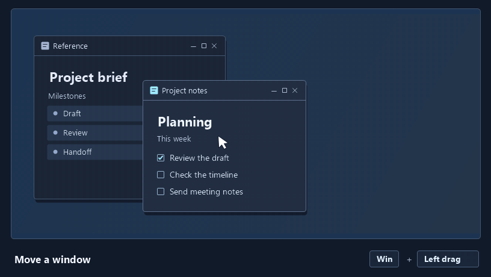
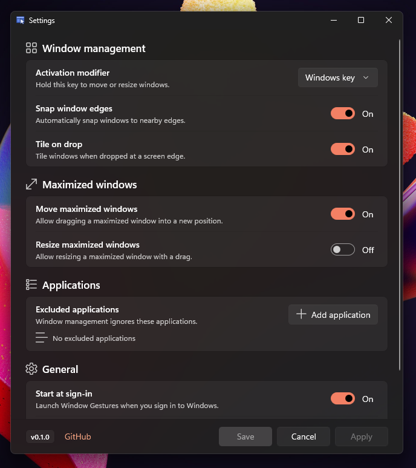
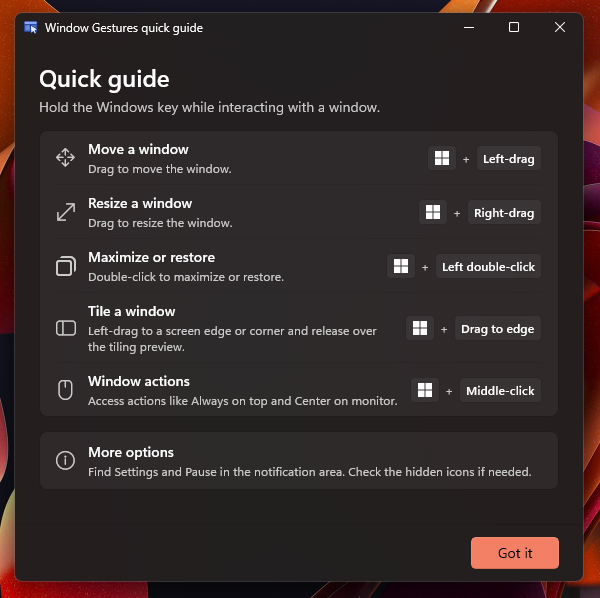

# Window Gestures

Hold the Windows key and drag anywhere inside a window to move or resize it. Give a crowded window more room, pull a window onto another monitor, or tile two apps side by side without hunting for title bars or resize handles.

## Get started

 • 

[All releases](https://github.com/apricotbucket28/window-gestures/releases)

## Default gestures

Hold the **Windows** key while using the mouse over the window you want to control.

| Gesture           | What it does                                                                          |
| ----------------- | ------------------------------------------------------------------------------------- |
| Left-drag         | Move the window from wherever you grabbed it.                                         |
| Right-drag        | Resize from the nearest edge or corner.                                               |
| Left double-click | Maximize or restore the window.                                                       |
| Middle-click      | Open window actions such as Always on top, Center on monitor, and Open file location. |

As you move a window, its edges snap to nearby windows and screen boundaries. To tile it, left-drag to a screen edge or corner and release over the highlighted preview. Drag a tiled window back out to restore its previous size.

In Settings, you can switch from Win to Alt, turn snapping and tiling on or off independently, exclude specific apps, choose whether to start Window Gestures at sign-in, and more.

## Building and packaging

See [BUILDING.md](BUILDING.md) for prerequisites, commands, and instructions for producing the portable ZIPs and installer.

## Credits

Window Gestures is inspired by [AltSnap](https://github.com/RamonUnch/AltSnap). It is licensed under the [GPL-3.0-or-later](LICENSE).

## Screenshots

